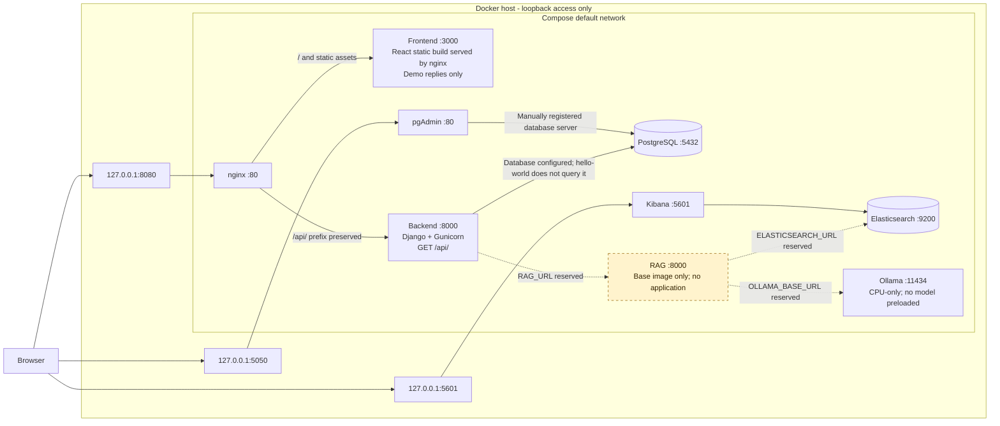
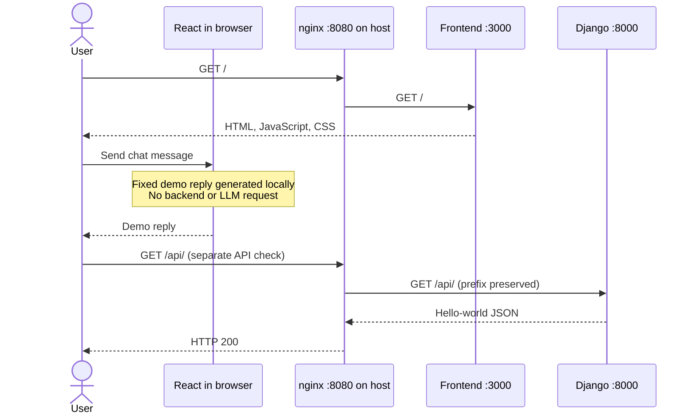

# Docker services and default endpoints

Reference for the current development stack in
[docker-compose.yml](../docker/docker-compose.yml).
See [Testing the development stack](testing.md) for setup, verification, and
troubleshooting commands.
Before deploying outside local development, use the
[production deployment checklist](production-checklist.md).

## Architecture at a glance

Solid arrows show configured routes or connections. Dashed arrows show reserved
connections that are not implemented. Host ports below are the defaults.



The browser does not call Docker service addresses directly. nginx forwards
requests on the shared network. The frontend currently has no API integration,
and Django does not call RAG or Ollama yet. All future chat/retrieval requests
must pass through the backend, which is responsible for authentication,
authorization, and validation before calling RAG internally.

### Current request paths



## Browser access

After configuring the environment and running `make start`:

| Address | Purpose | Current behavior |
|---------|---------|------------------|
| <http://localhost:8080/> | Frontend through nginx | React chat with fixed demo replies |
| <http://localhost:8080/api/> | Django through nginx | Hello-world JSON |
| <http://localhost:5601/> | Kibana | Elasticsearch management UI |
| <http://localhost:5050/> | pgAdmin | PostgreSQL management UI; login required |

These are default ports. `HTTP_PORT`, `KIBANA_PORT`, and `PGADMIN_PORT` in
[docker/.env](../docker/.env) override the published ports. Both bindings use
`127.0.0.1`, so they are intended for access from the Docker host, not other
machines on the network.

## Service inventory

All services use `restart: unless-stopped`. Compose generates container names;
use the service names below for internal connections and Make commands.

| Service | Image or build source | Internal address | Host access |
|---------|-----------------------|------------------|-------------|
| `nginx` | `nginx:1.31.8-alpine` | `http://nginx:80` | `127.0.0.1:8080` |
| `postgres` | `postgres:18.7-alpine` | `postgres:5432` (PostgreSQL protocol) | Not published |
| `pgadmin` | `dpage/pgadmin4:9.19.0` | `http://pgadmin:80` | `127.0.0.1:5050` |
| `elasticsearch` | `docker.elastic.co/elasticsearch/elasticsearch:9.5.6` | `http://elasticsearch:9200` | Not published |
| `kibana` | `docker.elastic.co/kibana/kibana:9.5.6` | `http://kibana:5601` | `127.0.0.1:5601` |
| `ollama` | `ollama/ollama:0.40.16` | `http://ollama:11434` | Not published |
| `frontend` | [Frontend Dockerfile](../srcs/frontend/Dockerfile) | `http://frontend:3000` | Through nginx |
| `backend` | [Backend Dockerfile](../srcs/backend/Dockerfile) | `http://backend:8000` | Through nginx at `/api/` |
| `rag` | [RAG Dockerfile](../srcs/RAG/Dockerfile) | Planned: `http://rag:8000` | None; backend access only |

Image defaults are pinned in Compose. Elasticsearch and Kibana share the
`ELASTIC_VERSION` override; Ollama uses `OLLAMA_VERSION`, and pgAdmin uses
`PGADMIN_VERSION`.

### Connect pgAdmin to PostgreSQL

- Add `PGADMIN_DEFAULT_PASSWORD` to [docker/.env](../docker/.env) if your file
  predates pgAdmin. Use a unique password, different from the database password.
- Run `make pgadmin` (and `make postgres` if PostgreSQL is not already running).
- Open <http://localhost:5050> and log in using `PGADMIN_DEFAULT_EMAIL`
  (default `admin@example.com`) and `PGADMIN_DEFAULT_PASSWORD`.
- Choose **Register > Server**, give it a name such as `RAG42`, then use the
  connection values below.

| Connection field | Value |
|------------------|-------|
| Host name/address | `postgres` |
| Port | `5432` |
| Maintenance database | `POSTGRES_DB` value; default `rag42` |
| Username | `POSTGRES_USER` value; default `rag42` |
| Password | `POSTGRES_PASSWORD` value |

Use the Docker hostname `postgres`, not `localhost`. The pgAdmin login and
PostgreSQL credentials are separate accounts. Server registration is manual;
no database passwords are embedded in a committed server configuration.
The initial pgAdmin account is persisted in its volume: changing
`PGADMIN_DEFAULT_PASSWORD` later does not reset an existing account's password.

### Application images

- **Frontend:** Node.js `26.13.1-alpine` builds the React/TypeScript application
  with Vite. nginx `1.31.8-alpine` serves the compiled static files on port `3000`
  as a non-root user. Vite does not run inside the final image.
- **Backend:** Python `3.15.2-slim`, Django `6.1.3`, Gunicorn `27.0.1`, and
  Psycopg `3.3.9`. Gunicorn serves `config.wsgi:application` on `0.0.0.0:8000`
  as a non-root user.
- **RAG:** Python `3.15.2-slim` base running as a non-root user. Its command
  expects `app.py`, which does not exist yet. Port `8000` is a proposed contract,
  not a working endpoint.

## Internal networking

Compose places the services on its automatically created default network.
Services resolve one another by service name, not by a fixed IP.

- From the backend, PostgreSQL is `postgres:5432`.
- From another container, Ollama is `http://ollama:11434`.
- `localhost` inside a container refers to that container, not the Docker host
  or another service.
- The backend and RAG can both use port `8000` because they have different
  container IP addresses.
- `expose` documents container ports; it does not publish them to the host.
- This network is not configured with Docker's `internal: true` isolation.

Browser JavaScript cannot resolve Docker service names. It should use
same-origin paths such as `/api/` through nginx, rather than `http://backend:8000`.
The current demo chat does not make API requests.

## nginx routing

The gateway mounts [docker/nginx.conf](../docker/nginx.conf) read-only.

| Incoming path | Upstream | Prefix handling |
|---------------|----------|-----------------|
| `/` and paths not matched below | `http://frontend:3000` | Request URI preserved |
| `/api/` and its subpaths | `http://backend:8000` | `/api/` preserved |

For example, `/api/` reaches Django as `/api/`, not `/`.
Routing a prefix does not create application endpoints under it.

- Docker DNS is resolved using `127.0.0.11` with a 10-second validity.
- Host, client IP, forwarded IP chain, and protocol headers are forwarded.
- RAG has no public proxy or published host port. Only the backend should call it.
  The shared development network is not an access-control boundary between
  containers; production network segmentation is still required.
- `/api/` has no custom read timeout or streaming configuration.
- No HTTPS listener, certificates, or gateway authentication are configured.

The frontend has a separate [nginx configuration](../srcs/frontend/nginx.conf)
inside its image. It serves static files and returns 404 for missing paths;
there is no client-side router fallback.

## Existing application endpoint

### `GET /api/`

Returns the backend hello-world response. No request body or authentication is
required.

```bash
curl --fail --show-error http://localhost:8080/api/
```

**Response: HTTP 200, `Content-Type: application/json`**

```json
{"message":"Hello world!","service":"backend"}
```

- `HEAD /api/` is supported and returns no response body.
- Unsupported methods are rejected. POST requests without a valid CSRF token
  can be rejected by middleware with 403; requests reaching the view with an
  unsupported method receive 405.
- Unknown API paths, including `/api/chat/`, return 404.
- Django only accepts the configured hostnames; other hosts return 400.

There is no chat API, Django admin route, or RAG endpoint yet.

## Environment configuration

Run `make setup` to create the ignored environment file from
[.env.example](../docker/.env.example). Set a unique password before starting.
An existing environment file is never overwritten by `make setup`.

### Compose settings

| Variable | Default | Used by |
|----------|---------|---------|
| `HTTP_PORT` | `8080` | nginx host port |
| `KIBANA_PORT` | `5601` | Kibana host port |
| `PGADMIN_PORT` | `5050` | pgAdmin host port |
| `PGADMIN_DEFAULT_EMAIL` | `admin@example.com` | Initial pgAdmin login |
| `PGADMIN_DEFAULT_PASSWORD` | Required; no Compose default | Initial pgAdmin login password |
| `PGADMIN_VERSION` | `9.19.0` | pgAdmin image tag |
| `POSTGRES_DB` | `rag42` | PostgreSQL initialization and Django database name |
| `POSTGRES_USER` | `rag42` | PostgreSQL initialization and Django database user |
| `POSTGRES_PASSWORD` | Required; no Compose default | PostgreSQL initialization and Django database connection |
| `ELASTIC_VERSION` | `9.5.6` | Elasticsearch and Kibana image tags |
| `OLLAMA_VERSION` | `0.40.16` | Ollama image tag |

The password in the example file is only a placeholder. Changing initialization
variables does not update credentials in an already initialized PostgreSQL
volume.

### Container connection settings

| Container | Setting | Configured value | Status |
|-----------|---------|------------------|--------|
| Backend | `POSTGRES_HOST` | `postgres` | Used by Django |
| Backend | `POSTGRES_PORT` | `5432` | Used by Django |
| Backend | `RAG_URL` | `http://rag:8000` | Reserved; no client implemented |
| RAG | `ELASTICSEARCH_URL` | `http://elasticsearch:9200` | Reserved; application missing |
| RAG | `OLLAMA_BASE_URL` | `http://ollama:11434` | Reserved; application missing |
| Kibana | `ELASTICSEARCH_HOSTS` | `["http://elasticsearch:9200"]` | Used by Kibana |

The backend has no configured Ollama URL or model selection yet.

### Django settings

[Django settings](../srcs/backend/config/settings.py) also support:

| Variable | Default | Notes |
|----------|---------|-------|
| `DJANGO_ALLOWED_HOSTS` | `localhost,127.0.0.1,backend,nginx` | Comma-separated hostname list |
| `DJANGO_SECRET_KEY` | Generated at process startup | Set a stable secret before adding sessions or authentication |

These two variables are **not currently passed through by Compose**. Adding
them only to the Compose environment file will not configure Django; also wire
them into the backend service's `environment` section.

`DEBUG` is disabled. Django includes CSRF and security middleware. The current
hello-world route does not query the database.

## Persistence

| Named volume | Container mount | Stored data |
|--------------|-----------------|-------------|
| `postgres_data` | `/var/lib/postgresql` | PostgreSQL database files |
| `pgadmin_data` | `/var/lib/pgadmin` | pgAdmin accounts, saved servers, and preferences |
| `elasticsearch_data` | `/usr/share/elasticsearch/data` | Elasticsearch indices |
| `ollama_data` | `/root/.ollama` | Downloaded Ollama models and local state |

`make down` preserves these volumes. PostgreSQL 18 uses a different data layout
from older images; PostgreSQL 17 files need a proper migration before reuse.

No application source bind mounts are configured. After source changes, use
`make frontend` or `make backend` to rebuild and recreate the corresponding
container. `make restart` alone does not rebuild images.

## Startup and health checks

| Service | Declared startup dependencies | Container health check |
|---------|-------------------------------|------------------------|
| nginx | Frontend and backend started | None |
| PostgreSQL | None | `pg_isready` every 10 seconds |
| pgAdmin | PostgreSQL healthy | HTTP `/misc/ping` every 10 seconds |
| Elasticsearch | None | Cluster reaches yellow or green; checked every 10 seconds |
| Kibana | Elasticsearch healthy | None |
| Ollama | None | `ollama list` every 10 seconds |
| Frontend | None | None |
| Backend | PostgreSQL healthy and RAG started | None |
| RAG | Elasticsearch and Ollama healthy | None |

- `make start` starts the eight implemented services, excluding RAG. It uses
  `--no-deps` and waits up to 180 seconds for configured container health checks.
  Declared dependency ordering is bypassed.
- `make <service>` also bypasses dependencies, but does not wait for readiness.
- `make up` follows declared dependencies and includes the unfinished RAG
  service; it is not the recommended startup command yet.
- A running container without a health check is not proof of application
  readiness. Use `make check` for live checks; Kibana may need extra startup time.
- Ollama runs CPU-only with no model preloaded. A healthy server does not prove
  a model is available or that inference works.

## Development-only limitations

- Elasticsearch is single-node with authentication/TLS disabled and a 512 MiB
  JVM heap.
- nginx, Kibana, and pgAdmin are only published on the host loopback interface.
- The application has no connected chat, retrieval, ingestion, or inference flow.
- Local Vite development uses `make frontend-dev` at `http://localhost:3000`.
  This bypasses Docker nginx; no Vite `/api/` proxy is configured.

For commands and expected results, see the [testing guide](testing.md).
